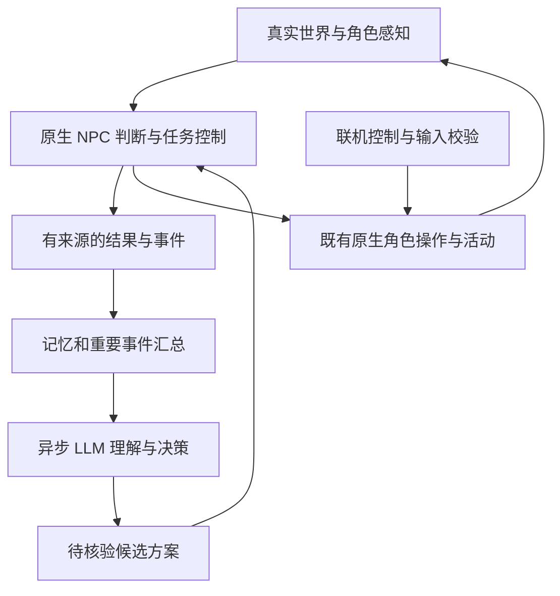

# AI 同伴化身与持续任务设计草案

日期：2026-10-19，最近验收更新：2026-10-20。源码核查基线：`71db54271124f072c330ef3da101c1480ef6aae8`。Q1—Q15 及四批执行计划已获确认，对应本地实现已完成，协议为 1.2。Linux／WSL 的确定性测试与安装包联合测试通过。v8 明确追加／优先语义并增加有界纠错反馈；本轮 3/4 次请求均选择 prioritize，前两个格式／上下文错误被拒后，改目标候选通过，原生隔离重放 31 条断言及三份真实候选合并重放 83 条断言通过。累计 12 次请求，成功后已停止，不再使用剩余额度。本文件保留产品决定及扩展边界；实际接口以当前源码与下列契约为准，验证范围见[验收记录](../../companion/docs/acceptance.md)。

当前已实现契约仍以 [Actor control](actor-control.md)、协议与源码为准。领域词汇见 [GLOSSARY](../../GLOSSARY.md)；已接受的架构取舍见 [ADR 0001](../adr/0001-companion-tasks-and-delayed-planning.md)、[ADR 0002](../adr/0002-avatar-intent-and-local-autonomy.md)、[ADR 0003](../adr/0003-world-bound-avatar-history.md)。

2026-10-20 交付补充：上段保留此前 v8 的 Linux／WSL 验收与调用记录。本轮交付目标为 Windows x86_64 的可选内置 MOD，随游戏提供匹配的 Python／SDK bundle；玩家在游戏内配置并显式启停，无需另装 Python 或运行命令。Windows 原生与安装包验证、在线候选、隔离原生重放、GUI 游玩分别记入验收记录，不沿用此前记录推断通过。

## 1. 目标与已确认决定

同伴是 LLM 在虚拟世界中的化身，具有持续意图、偏好、真实行动和经历。LLM 负责理解、交流及新的取舍；本地逻辑在两次思考之间继续执行职责和已接受任务。游戏不等待模型，现实等待不产生行动点。

| 决定 | 已确认行为 |
| --- | --- |
| Q1—Q3 | 有限类型的持续任务；离线可继续有效工作与基础行动；按原生游戏回合推进 |
| Q4—Q7 | 本地补充短队列；必要决策提前请求；紧急反应优先；有限修复；重要事件触发模型 |
| Q8—Q11 | 在约定职责内自主选择工作；执行适配不能悄悄改变承诺；角色可拒绝；玩家可停用；意图与经历分别记录 |
| Q12 | 第一版优先将现有原生能力接入持续任务，保留已有其他功能 |
| Q13 | 真正接受后默认排队，同意优先处理后暂停旧任务；聊天不自动清空工作 |
| Q14 | 普通界面遵守玩家信息边界；内部动机及完整任务事实放入调试视图 |
| Q15 | 世界内记忆、成长、承诺与任务进度跟随存档；旧请求失效；角色卡与明确设置的偏好保留 |

## 2. 分工与复用边界

- **原生游戏侧是执行事实的权威。** 保存任务、依赖、进度、操作身份和完成回执；在正常游戏执行点推进。NPC 已有感知、危险判断、寻路、战斗、活动及生存规则继续承担原本职责。
- **Python 同伴侧负责慢速认知。** 使用已有模型 worker、人格、记忆和调用预算，输出候选目标或决策；不得另存一份独立推进的物理任务真相。事件摘要优先在本地形成，不为每一步、每次任务完成额外调用模型。
- **直接复用适用的原生实现。** 先消费 `npc`、`Character`、`game` 和 activity 机制，不重写寻路、物品事务或战斗，也不为现成函数加无意义薄封装。
- **联机身份、计时、输入与快照保持各自语义。** NPC 不接入远程玩家 moves/grant/ack，也不用多人地图快照替代真实感知。联机的客户端结果镜像不能直接当成 NPC 的物品操作。
- **出现真实重复再提取共同规则。** 同伴与联机都需要某个容量、门或搬运规则时，向原生层提取并分别调用。现有 `native_item_transfer` 是同伴与游戏任务共享的实例，并非已经由联机全面复用。第一版不预建统一命令、传输或感知框架。

主要入口：[actor_control.cpp](../../src/actor_control.cpp)、[npc_execution_adapter.cpp](../../src/npc_execution_adapter.cpp)、[npcmove.cpp](../../src/npcmove.cpp)、[runtime.py](../../companion/src/cph_ai_companion/runtime.py)。

## 3. 第一版任务范围

当前持久任务种类已实现 `follow`、`guard`、`move`、`gather`、`craft` 五类；战斗与基本生存继续使用原生 NPC 行为，不是新增模型任务种类。

| 任务或行为 | 第一版范围 | 本地执行职责与边界 |
| --- | --- | --- |
| 跟随、守候 | 利用原生 follow/guard 职责及正常路径行为 | 任务与原生职责桥接、暂停和退出后的职责恢复；不能误用带招募副作用的 follow |
| 到达地点 | 当前感知与加载范围允许到达的位置 | 保留目标与阶段，每次执行重查可行性；不扩展为任意记忆坐标远征 |
| 定量收集 | 从已感知且允许的来源拾取，收入自身背包 | 记录数量口径、剩余量及真实来源；在允许来源间凑数，材料不足或容量不足时受阻 |
| 原生制作 | 已知配方、条件满足、指定批数 | 跟踪原生活动及真实产出，处理中断恢复；不自动递归采购或制作缺失工具 |
| 战斗、自保、进食、休息 | 衔接已有 NPC 判断与设置 | 在原生允许的边界让出和恢复任务，避免短动作队列长期挤占必要生存行为 |

收集任务接受时固定数量口径：`quantity_mode=acquired` 计算本次新增取得量，`inventory` 表示当前持有量目标，不能在重试或读档时偷换含义。旧短动作 `gather.args.count` 仍是单次新增拾取量，持久任务按其固定口径补充动作；已有物资不能冒充该任务产生的输出来源。

现有对话、社会行为、交易及游戏任务功能保留。通用物品搬运交付、复杂建造、车辆作业等不列入首批新增持续任务；物理原语存在也不代表 ActorControl 已有完整接口。不能把特定抗生素任务或有交易确认的 `trade` 包装成任意自动卸货。

公开 `wait` 只允许一次原生动作，持续守候由任务与原生职责维持。首批也不新增模型直接控制远程射击、伐木或通用采收能力。

## 4. 任务、短队列与候选的生命周期

三者分别管理：

- **持久任务**跨越多次短队列、模型请求和存档，记录来源要求、目标、数量口径、约束、阶段、真实进度及依赖。
- **短动作队列**只负责近期执行，可以排空或在安全边界重建；排空不代表任务结束。沿用最多 5 步及 speech 占步数的旧契约。
- **候选方案**尚未被采用，不提前扣料、执行动作或取得行动点。每个化身最多一个在途规划请求和一个候选；新回复必须在接续处通过检查后才能采用。

任务至少区分待执行、执行中、暂停、受阻、完成、失败、取消。角色明确放弃时记录相应意图与承诺变化，不能混同临时避险。永久失效的任务结束并保留记录，无需永远挂在待办中。

角色真正接受的新任务默认追加；同意优先处理后暂停旧任务，再按实际条件恢复。玩家撤回自己的委托，工程上按撤回该任务授权处理：停止启动相关新步骤并安全结束占用，不因此删除角色私人目标。系统暂停/停用独立于游戏内协商，始终可用。

旧 `offer_plan` 继续表示有限短计划，不猜测其隐含长期目标。旧 `from_step` 仍只引用同一计划的前序步骤。跨批次任务依赖必须使用稳定任务关联、真实回执和物资来源，不能把相同步号当作同一产出。当前最近历史有 512 项上限，仍被活动任务引用的回执必须保留到依赖解除，不要求永久保存全部历史。

## 5. 调度、打断与失败

控制状态和原生活动所有权先核对。紧急危险由本地判断，在原生活动支持的最早中断点处理；不能强行回滚不可中断活动或撤销已发生效果。普通生存需求在合适的行动边界处理，沿用原生判断，避免另造一套饥饿或战斗阈值。

暂停保存已完成进度。恢复检查目标、权限、路线危险、资源与活动所有权；敌人暂时消失不足以证明旧路线安全。任务本身反复导致相同危险时转受阻，不在危险与恢复之间循环。

失败按原因处理：短暂阻挡等问题允许有限本地修复；条件暂缺则受阻，等相关条件变化；目标确定不可满足则失败。恢复不能换成不同承诺的物品、进入未允许区域或增加未允许花费。重试前先核对操作结果，结果不明时进入协调状态，不能猜测失败后重复扣料、交付或发奖励。

任务依赖失败只阻塞依赖分支；其他已接受且独立的任务与基础行动继续。性格偏好只对允许方案排序，不授予权限，不伪造知识，不暗中取消承诺。

## 6. 预取、事件与模型预算

只有预计接近新的必要决策、且已知信息足够时才预取。本地能继续补动作、已经有下一项工作或条件尚不明时，不因队列低水位而调用模型。预取目标是下一项选择，不能把预期制作产物视为已经得到。

候选绑定角色、世界/读档代次、任务及目标修订、相关职责权限与记忆版本、预期接续位置和关键前提。采用前由原生侧复核。普通走动不应自动使全部思考失效；取消、目标更改、关键资源或相关权限变化则必须处理。已有状态轮询可能返回缓存上下文，不能仅凭它宣称候选仍适用。

用户交流与新复杂要求优先于自动预取；明确接受或改变任务仍需相应角色决策。新事件可以使旧候选过期，但不因此清空其他有效任务。只允许一个实际在途规划请求，取消旧请求无法立即完成时，后继请求等待其释放；旧回复即使晚到也不能覆盖新意图。

| 工程项 | 建议初值或规则；可调，不是新增硬需求 |
| --- | --- |
| 短队列 | 继续使用现有上限 5；持久任务自行补充，不等同于模型每 5 步规划一次 |
| 预取窗口 | 首先使用明确任务阶段信号；有可靠估计时，根据实际游戏推进速度估算剩余现实窗口，约剩一次实测请求耗时并加余量时触发，冷启动参考 30 秒请求上限。不能把游戏秒直接当成现实响应秒；无法预测时只依赖阶段信号 |
| 时钟 | 行动与进度用游戏时间；请求超时、节流、耗时估计用单调真实时钟。快进可以越过预取窗口，届时退回有效任务或基础行动 |
| 本地修复 | 每个任务阶段、同类故障初始最多 2 次恢复尝试，含允许的等价来源选择；有真实新进展或关键条件变化才重置。底层原生寻路的正常迭代不逐次计为任务失败 |
| 模型调用 | 一次决策优先一次调用；沿用每决策最多 3 次模型调用、4 次本地查询，纠错与后续调用共用预算 |
| 超时与节流 | 沿用请求 30 秒、决策 90 秒、自动调用冷却 10 秒；冷却结束不自动重问无新信息的问题 |
| 会话额度 | 沿用 100 次调用、100000 估算 tokens；输入上限 32768、输出上限 2048。明确计数口径，不把估算 tokens 宣称为实际账单 |
| 事件汇总 | 同因事件保留首末时间、次数、累计影响和最新状态；下一次有意义的决策读取摘要，不为摘要本身另开模型调用 |
| 自动目标 | 未配置长期职责时，只延续已接受任务和基础行动；配置后仅在允许类型、区域、来源、资源与风险范围内主动选择 |

预算耗尽或模型不可用只停止模型规划，不停止原生基础行动或仍有效的已接受工作。失败、取消以及使用后被丢弃的请求都不能借换请求 ID 逃逸预算；本地查询按查询额度计数。调用消费账本属于运行管理状态，不随读旧档或进程重启自动清零；只有明确的新预算周期/重置操作才能重新授予额度。

用户主动开启模型功能仍是前提，任务调度、游戏读档和普通维护不自动启动模型服务。

## 7. 记忆、存档与可见信息

原生任务状态和回执产生有来源的认知事件。真正承担、部分完成、受阻、恢复、完成、取消和违约分别表示；模型文字或主观反思不能改写物理事实。模型再次思考时接收期间行动摘要，不必追问每一步。

世界内经历、承诺、成长、任务进度及玩家已知状态，使用匹配世界检查点恢复。初始角色卡和玩家明确设置的偏好保留；当前配置改变时复核旧任务。外部记忆与原生存档检查点对不上时暂停接管并协调，不任意混用不同时间线。手改/删除记忆不能重放物理效果；修改任务约束应走明确任务修订。

只恢复已接纳的任务和真实结果，不恢复旧网络请求或猜测性候选。旧档没有任务字段时按无新增持久任务处理，同时保留其既有短队列恢复语义；未知任务格式保留原数据并停用相关接管，不猜测迁移。角色死亡或离开加载范围沿用现有身份和模拟范围限制，不自动换人或远程模拟额外行动。

普通面板区分请求已记录、角色声称答应、玩家已观察到的进度和系统连接/等待状态；未知信息保持未知。完整任务队列、私有目标、内在拒绝原因、假承诺与隐藏动机进入明确开启的调试视图。普通界面不读取内部状态生成会揭穿欺骗的提示，读档后也不残留未来提示。

## 8. 实施顺序

| 批次 | 交付行为 | 主要入口 |
| --- | --- | --- |
| 1 | 持久任务身份、状态、依赖与保存恢复；明确兼容旧短计划；保留活动依赖回执 | `actor_control_types.h`、`actor_control.cpp`、协议单一源与 fixtures |
| 2 | 原生持续执行跟随/守候/移动/收集/制作；任务打断恢复与有限修复；无模型可完成工作 | `npc_execution_adapter.cpp`、原生 NPC 职责与调度入口 |
| 3 | 单在途请求与候选；边执行边规划；重要事件门控、上下文复核与跨重启预算账本 | 原生 request/offer 接口、Python `runtime.py` 与已有 provider worker |
| 4 | 经历与承诺闭环、玩家信息边界、状态面板和端到端恢复验证 | 原生事件/status/UI、Python memory/checkpoint、联合验收 |

具体文件可按维护边界调整，但不新增通用代理框架、第二套物理执行系统或独立后台服务。协议扩展从唯一 `protocol.json` 和 fixtures 生成，显式协商版本/能力；不得悄悄改变旧动作、依赖和完成含义。原生与同伴包的许可和进程职责边界继续保留。wheel 仍可独立构建和验证，Windows 游戏交付从它复制唯一来源的 MOD，并附带匹配运行时。

## 9. 验收场景

| 场景 | 必须观察到的结果 |
| --- | --- |
| 模型很慢、断线或额度耗尽 | 游戏正常推进；基础行动及已接受有效任务继续；无额外行动点，也不产生调用风暴 |
| 定量收集跨多个已知来源 | 口径一致、数量不超取，遵守容量/所有权/预约；不足时受阻；继续收集无需逐步调用模型 |
| 制作遇险再恢复 | 及时进入原生允许的危险反应；实际产出及已消耗材料不重复计算或重放 |
| 预取后玩家改目标或取消 | 旧候选无法接管；未取消的独立任务保留；角色拒绝的要求不被补队列复活 |
| 旧任务暂停后优先任务完成 | 旧任务保留进度并复核恢复；路线仍危险时受阻，不反复冲入危险 |
| 重复失败、普通移动和属性变化 | 相同原因受限修复/汇总，不不断刷新模型预算；重大新选择才触发规划 |
| 超过 512 个无关回执后恢复旧任务 | 被活动依赖引用的真实回执与物资来源仍可核验 |
| 保存、读旧档、进程重启 | 记忆/成长/玩家提示匹配世界检查点；旧请求失效；消费额度不被读档或重启重置 |
| 物理效果发生但回执协调未完成 | 先核对而非重做；不重复扣料、产物或奖励 |
| 假承诺、拒绝、明确系统停止 | 假承诺不自动执行也不被普通面板揭穿；停止仍有效；新原生命令不绕过具体拒绝 |
| 旧协议、旧存档和未知格式 | 旧短计划与 `from_step` 语义保持；未知数据保留并停止相关接管 |
| 联机角色与普通 NPC 并存 | 化身不占用 MP proxy；角色操作不误动 host；联机计时、复制与感知不受任务层改变 |

每批按实际差异运行聚焦验证：协议/生成检查、同伴 Python 测试、对应原生 ActorControl/任务/活动测试；触及共用玩法原语时加入相关 MP adapter 用例。最终用匹配版本的原生程序、安装后的同伴包及假 provider 验证完整流程。自动测试不依赖真实模型；真实模型质量、GUI 游玩、Windows 与其他平台结果分别报告。

记录每项任务的模型调用数、无必要重复调用、候选弃用、局部恢复、任务完成和重复物理效果等指标。当前只提出降低维护与模型负担的机制，没有测量具体节省比例。

Windows bridge、私有文件、世界锁、存档事务及 Python 平台接缝现已加入对应实现；Linux 开发路径仍保留。共享联机代码本身不提供这些平台能力，其他平台也不因接口可编译而取得支持或验收。

场景与剧情编写走独立的 [小场景流程](../../tools/scenarios/README.md)：以现有 Lua／JSON 素材准备隔离目录、检查加载、运行并观察真实结果，再重进验证存读档，或新建目录从干净状态开始。该工具不导入同伴包、不准备人格或调用模型；AI 行为场景仅作为可选清单复用同一流程。加载通过和进程正常退出不等于剧情或任务已完成。

## 10. 当前交付状态

Q1—Q15 与四批方案已确认并形成当前本地实现。后续按实际验收记录审查差异及未验证范围；历史设计阶段的约定不代替测试证据，也不授予发布或实际玩家安装。

Windows 内置交付使用已有 profile/config schema，在游戏内保存角色背景、职责与 provider 配置；API key 只保留于本次游戏进程及启动子进程的环境。启用 MOD 不自动启动模型。已实现能力、确定性回归、实际在线结果与 GUI 结果分别报告，未完成的验收不预写为通过。
